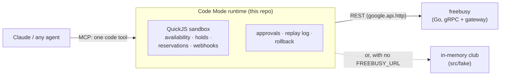

<!-- Copyright 2026 Srikanth K. -->
<!-- SPDX-License-Identifier: Apache-2.0 -->

# freebusy-codemode

**A demo of [Code Mode](https://github.com/the-protobuf-project/codemode) over
a real API.** It exposes [freebusy](https://github.com/shokki-engineering/freebusy),
a booking engine, to AI agents as a typed TypeScript sandbox. The agent writes
one script instead of making one tool call at a time.

Everything under `gen/` is generated from freebusy's published protos by
`protoc-gen-codemode`. freebusy itself is unchanged: its protos carry no
Code Mode annotations, so the sandbox policy lives in
[`codemode.yaml`](codemode.yaml).

> Work in progress, like Code Mode itself. Expect breaking changes before v1.



## What the agent writes

Booking is three steps in freebusy: find a free window, take a hold, confirm it
as a reservation. With Code Mode the agent does all three in one script:

```ts
async () => {
  const window = { startTime: "2026-12-01T19:00:00Z", endTime: "2026-12-01T20:30:00Z" };
  const found = await availability.searchAvailability({ window, resourceTypes: ["padel"] });
  const hold = await holds.createHold({
    hold: { window, candidateResources: found.matches.map((m) => m.resource) },
    requestId: "booking-1",
  });
  const r = await reservations.createReservation({
    reservation: { hold: hold.name, customer: "users/ada" },
  });
  return { court: r.resources, reservation: r.name };
}
```

The runtime adds the safety around it:

- **Approval.** The script pauses before `createReservation`. A person approves
  it, and the script resumes from its log: the search and the hold are not
  repeated.
- **Rollback.** If a script fails after taking a hold, rolling it back calls
  `holds.releaseHold`, so a half-finished booking never keeps a court.
- **Typed errors.** freebusy's errors reach the script with their gRPC code, so
  `catch (e) { if (e.code === "RESOURCE_EXHAUSTED") ... }` works.

## Try it

You need [Bun](https://bun.sh). The runtime packages are on GitHub Packages,
which needs a GitHub token even for public packages (any token with
`read:packages`):

```bash
export GITHUB_TOKEN=$(gh auth token)   # or a personal access token
bun install
bun run demo
```

`bun run demo` books a court at an in-memory four-court club: a read, a booking
that pauses for approval and resumes, and a failed script that is rolled back.

### With Claude

Claude Code:

```bash
claude mcp add freebusy -- bun "$PWD/src/mcp.ts"
```

Claude Desktop: add this to `~/Library/Application Support/Claude/claude_desktop_config.json`
under `mcpServers`, with your own paths (Desktop needs the full path to `bun`),
then quit and reopen Desktop:

```json
"freebusy": {
  "command": "/opt/homebrew/bin/bun",
  "args": ["/path/to/freebusy-codemode/src/mcp.ts"]
}
```

Then ask something like *"Find a free indoor padel court tomorrow between 6
and 9pm and book the earliest for users/ada"*. Claude gets one `code` tool and
writes a script against the API in
[`gen/codemode/sandbox.d.ts`](gen/codemode/sandbox.d.ts).

**Claude cannot approve its own bookings.** The server lists only `code` and
`codemode_status`, without `codemode_approve`. When a call needs approval, a
client that supports MCP elicitation asks you directly. Otherwise the script
waits, and you approve or reject it on a page served by the MCP server itself:
**http://127.0.0.1:4791** (`CODEMODE_APPROVALS_PORT`), or, if that port is
taken, the address Claude is given with the paused call. Claude then reads the
outcome with `codemode_status`.

Claude Desktop may start the server more than once. With the in-memory club
each copy has its own club, its own paused executions and its own page, so
approve on the page Claude names. Against a real freebusy the state is
freebusy's, and `CODEMODE_DB` keeps paused executions in SQLite across restarts.

Each Approve button approves exactly the call it shows. If a script books two
courts in parallel, you see two calls and approve each, and approving one
leaves the other waiting. After a click the page redirects to itself, so
reloading it never sends an approval twice. A history below lists every
approve and reject with its time and arguments, and `codemode_status` tells
Claude which calls you approved, so it can report them even when you approved
several on the page before replying.

The page listens on localhost only and accepts approvals only from itself, so
another website open in your browser cannot approve for you. Any program on
your machine can still reach it, so an agent with a shell or browser tool could
too.

### Against a real freebusy

Point the runtime at freebusy's REST gateway. Nothing else changes:

```bash
FREEBUSY_URL=https://freebusy.example.com FREEBUSY_TOKEN=... bun run demo
```

## The sandbox policy

Code Mode already pauses deletes, which it infers are destructive from their
AIP names. `codemode.yaml` adds what a booking engine needs:

| Method | Policy | Why |
|---|---|---|
| `reservations.createReservation`, `rescheduleReservation`, `cancelReservation` | approval required | Real customers' bookings |
| `webhooks.createWebhook`, `updateWebhook`, `rotateWebhookSecret` | approval required | Decide where booking data goes, and its signing secret |
| `holds.deleteHold`, `webhooks.deleteWebhook` | approval required | Inferred: destructive |
| `holds.createHold` | reverted by `holds.releaseHold` | Rollback frees the court |
| `availability.*` | replay: log | Availability changes with the script's own holds, so re-running a search on resume would return other courts |

Namespaces are renamed too: `allocation` becomes `availability`, `hold` becomes
`holds`.

## Layout

```
buf.gen.yaml     input: buf.build/shokki-engineering/freebusy, plugin: protoc-gen-codemode
codemode.yaml    namespaces, approvals, reverts, replay
gen/             generated: types, codecs, clients, connectors, sandbox.d.ts
src/runtime.ts   Code Mode over the generated catalog, in QuickJS
src/services.ts  a real freebusy (FREEBUSY_URL) or the in-memory club
src/mcp.ts       stdio MCP server
src/approvals.ts the local approval page
src/demo.ts      the scripted walkthrough
src/fake/        the in-memory club: availability, holds, reservations
test/            booking, approval, rollback, expiry and reschedule, end to end
```

## Regenerating

```bash
# codemode.yaml's services and methods sections need a plugin newer than v0.1.0
go install github.com/the-protobuf-project/codemode/plugin/cmd/protoc-gen-codemode@main
just generate
```

To pick up a new freebusy release, bump the label in `buf.gen.yaml` and
regenerate. A weekly workflow checks that `gen/` is current.

## License

Apache-2.0, the same as freebusy's protos.
